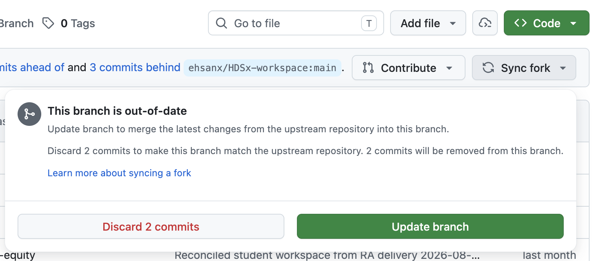
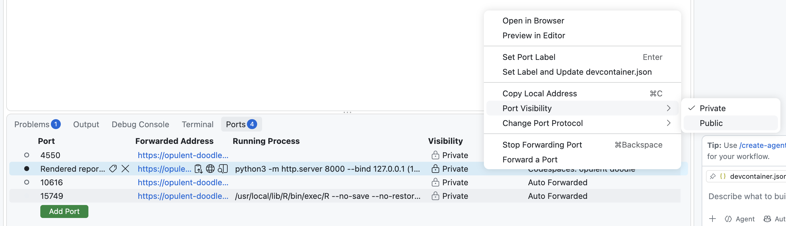
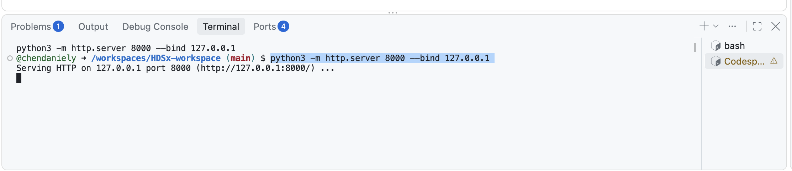

# Setting Up Codespaces, R Basics, Missing Values, and dplyr Verbs on NHANES

Instructor: Daniel Chen

## Summary

The session opened with setup fixes. In the previous week, students could not view a rendered Quarto report or a figure inside GitHub Codespaces without downloading it first. Daniel worked out a workaround with Claude's help. Students sync their fork of the course repository, delete and recreate their codespace, and then view rendered HTML reports through a simple browser on port 8000. He also explained how to stop a codespace properly and why you must commit and push before deleting one. Most students already had GitHub Copilot enabled, so he showed how to open Copilot Chat inside Codespaces. He gave a strong warning: any open file can be sent to the AI model, so private data must never be open when you chat.

Next came a hands-on review of R in the terminal. Topics included the assignment operator, what the `[1]` in printed output means, case sensitivity, and vectors built with `c()`. Every element of a vector must be the same data type. The central idea was missing data. R represents missing values as `NA`. By default `mean()` returns `NA` when any value is missing, and you must add `na.rm = TRUE` to drop missing values. Spreadsheets instead silently skip blanks. Daniel stressed that `NA`, the string `"NA"`, an empty string, and a space are all different things.

The second half used the NHANES equity dataset in the week's starter Quarto document. The class loaded it with `read_csv()` and inspected it with `dim()`, `names()` and `glimpse()`. Missing values were counted per column with `is.na()` and `colSums()`, first as nested functions and then rewritten with the pipe `|>`. The class then met the main dplyr verbs: `filter()`, `select()`, `mutate()` (including recoding BMI into categories with `case_when()`), `summarize()` and `group_by()`. The session finished by writing a custom function with Copilot's help.

The overall message was that AI tools now write most of the syntax. Your job is to know which tools exist, ask good questions of the data, and read the code carefully enough to check it and steer it, for example by telling the AI to use tidyverse style. The homework asks you to do all of this on NHANES: explore it, pose your own filtering question, write and reuse a function, and save a summary table.

## Knowledge Points

### 1. Getting and maintaining your Codespace

Daniel worked out this week's setup fix live, about an hour before class, so these steps aren't in the textbook yet. Do them once, in this order. They take about 10 minutes, mostly waiting.

1. Open your workspace repository on GitHub. It's the URL you submitted for last week's homework.
2. Click the green **Code** button, open the **Codespaces** tab, and click your codespace's randomly generated name to open it.
3. In the codespace, commit and push anything you want to keep. ⚠️ The next step deletes this codespace, and any work that isn't pushed to GitHub is gone for good.
4. Back on the repository page, click **Code → Codespaces** again and click the trash-can icon next to your codespace to delete it. A codespace keeps the setup it was built with, so you need a new one to get the fix.
5. On the same page, just under the **Code** button, click **Sync fork**, then click the green **Update branch** button. This copies the instructors' changes into your copy of the project.
   ⚠️ Do **not** click the red **Discard commits** button. It throws away your own commits.

   

6. Click **Code → Create codespace on main**. Setup takes about 5–10 minutes. Click **Trust folder and continue** if you are asked.

More about these steps:

- **Fork**: your own copy of the course's workspace repository, which you made in week 2. **Sync fork** brings in changes the instructors made after you forked it.
  - Syncing only removes your work if you click **Discard commits**. The instructors don't change the files you're asked to edit, and your homework is copied into your own folder, so their updates don't collide with your work.
  - Daniel expects to need a sync like this only rarely this term.
- **Stopping vs. leaving a codespace running**: when you finish working, stop the codespace from the Codespaces menu instead of waiting for auto-shutdown.
  - Stopping is like turning the computer off, so it restarts much faster than a new one.
  - Stopping also saves your monthly Codespaces usage. Usage allowances reset at the start of each month, and the next reset is 2026-10-01.
- **Dev Container**: the system that defines the pre-installed environment you work in inside GitHub Codespaces. You will see this term in the course textbook.
- **How to tell the environment has finished loading**:
  - In a `.qmd` file, headers appear bold and code chunks get a grey background.
  - The Extensions tab has stopped showing loading screens.
  - Typing `>Quarto` in the command palette shows Quarto commands. If nothing appears, Quarto has not loaded yet, so wait a minute.
  - If you start running commands too early, things fail even though nothing is actually wrong.

### 2. Viewing rendered reports through port 8000 (the new workaround)

Last week the only way to see a rendered report was to right-click the `.html` file and download it. The new setup runs a small web server inside your codespace, on **port 8000**, so you can read reports without leaving the editor. A **port** is a numbered channel a program uses to serve web pages. The **Ports** tab lists the ones Codespaces lets your browser reach.

1. Open your `.qmd` file and run **Quarto: Preview** from the command palette. Allow everything it asks for. This renders your document into an `.html` file.
2. At the bottom of the window, click the **Ports** tab, next to **Terminal**. Find the row for port **8000**. It's labelled **Rendered reports**, and its Running Process column shows `python3 -m http.server 8000`. Leave the other ports alone. If there is no port 8000 row, follow **If port 8000 is missing** below.
3. Right-click the port 8000 row and choose **Port Visibility → Public**. Its Visibility column changes from Private to Public.

   

   ⚠️ Public means anyone who has this port's web address can open the files in your codespace while it is running. That's fine in this course, which uses only public datasets. Never make a port public on a project that holds private data.

4. Right-click the row again and choose **Preview in Editor**. It is also one of the small icons next to the address. A small browser opens inside the editor. Click **Continue** at the warning, which appears because the port is public.
5. The small browser lists the same files and folders as the Explorer on the left. It can take a minute to load. Click through the folders to your `.html` file to see the rendered report.

The same update also fixes figures: running a single code chunk that makes a plot now shows the figure directly, without downloading it.

**If port 8000 is missing**

The server behind port 8000 normally starts by itself each time the editor connects to your codespace. If it didn't start, or the terminal it runs in was closed, the port disappears. Start it yourself:

1. Open the **Terminal** tab and click **+** to open a new terminal. Don't start R in this one.
2. Paste this command and press Enter:

   ```bash
   python3 -m http.server 8000 --bind 127.0.0.1
   ```

3. It prints `Serving HTTP on 127.0.0.1 port 8000` and then seems to stop, with no new prompt. That is correct: the server is running and waiting. Leave this terminal open, because closing it (or pressing Ctrl+C in it) stops the server. Click **+** again to open a separate terminal for R.

   

4. Go back to the **Ports** tab. Port 8000 is there now, so continue from step 3 above.

If the command prints `Address already in use`, the server is already running. Look for port 8000 in the Ports tab again.

### 3. R in the terminal

- **Starting R**: open the Terminal tab, click **+** for a new terminal, type `R` (capital R) and press Enter.
  - This is the same R that runs the code chunks in a Quarto document. Running a chunk sends its code to whichever terminal is running R.
  - If you type R code such as `3 + 3` without starting R first, the terminal (bash) does not recognise it.
- **Assignment operator `<-`**: this saves a value to a variable, such as `patient_age <- 55`.
  - Put spaces around it. Without spaces, R may read `<-` as "less than" followed by a negative number.
  - Assigning prints nothing. Type the variable name to see its value.
  - Every tool has quirks like this. In Excel, for example, a formula must start with `=`.
- **The `[1]` in printed output**: this is the position of the first value on that line, not part of your data.
  - Long output wraps onto new lines that begin with, for example, `[26]`, which means "this is item 26".
  - It is only there to help you see how many items there are. You can usually ignore it.
- **Case sensitivity**: `patient_age` and `Patient_age` are different names. The wrong case gives an "object not found" error.
- **String vs. variable**: `"Apple"` in quotes is literal text. `Apple` without quotes means "look up the variable called Apple". If no such variable exists, R reports *object not found*.
- **Error messages**: an R error begins with `Error` followed by a message. In spreadsheets, errors look like `#REF!` instead.
  - Example: `"Apple" + 5` gives *non-numeric argument to binary operator*. This means you tried to do arithmetic with something that is not a number.

### 4. Vectors and data types

- **Vector**: R's basic "list" of values, created with `c()` (short for *concatenate*).
  - Think of it like a shopping list: several items, and you can point to any one of them.
  - Every element in a vector must have the **same data type**. If you mix numbers with a string such as `"hello"`, R converts every element to text. Spreadsheets have the same problem when a column mixes numbers and text.
- **Square brackets `[ ]`**: pull items out by position. For example, `dim(nhanes)[1]` gives the number of rows.
  - ⚠️ Avoid hard-coding positions like "item 17" in analysis code. If new data arrives, or rows are sorted or added, the position changes. This is the same problem as relying on cell `B7` in a spreadsheet. Write code that finds the value you want instead.

### 5. Functions and arguments

- **Function**: a named operation you give inputs to, such as `mean()`. It works like `AVERAGE` in Google Sheets.
  - Each tool has its own names: Google Sheets uses `AVERAGE`, and R uses `mean()`. Some of this you simply have to learn over time.
- **Arguments / parameters**: optional settings that change what a function does, such as `na.rm = TRUE` or `show_col_types = FALSE`. Beginners can use the two words interchangeably, although technically they differ slightly.
- **Hover documentation**: in Codespaces, hover over a function name to see its help page. For example, `dim()` means "dimensions of an object", a term borrowed from matrix maths.
- **Nested functions**: in `f(g(x))`, the innermost function runs first and its result is passed outward. You read the code from the inside out.
- **`is...` naming convention**: functions whose names start with `is`, such as `is.na()`, return `TRUE`/`FALSE`.
- **TRUE/FALSE as numbers**: `TRUE` counts as 1 and `FALSE` counts as 0. Summing logical values therefore counts how many are `TRUE`.
- **Not operator `!`**: flips `TRUE` to `FALSE` and back. `!is.na(x)` means "is **not** missing".

### 6. Missing data (`NA`)

- **`NA`**: R's code for a missing value, written in capital letters with no quotes. It is often shown in red.
- **Missing is not zero**: filling blanks with 0 changes an average, because the zeros add nothing to the total but still increase the count you divide by. In the class example, the average of 10, 20 and 30 with blanks is 20, but with zeros in place of the blanks it is 10.
- **Default behaviour of `mean()`**: if any value is `NA`, the result is `NA`. R refuses to guess what you meant. You might want missing values skipped, you might have expected the data to be complete, or you might think missing should count as zero.
  - Add **`na.rm = TRUE`** ("NA remove") to drop missing values before calculating.
  - The dot in `na.rm` just separates two words in the name. It does nothing special.
  - If you get `NA` back from `mean()` on a column that clearly has numbers, missing values are the likely cause.
- ⚠️ **Spreadsheets silently ignore blanks**, and apparently any non-numeric cell, when averaging. Daniel called this "kind of terrifying", because the result looks fine while hiding the problem.
- **These are all different things**:
  - `NA`: missing.
  - `"NA"`: the literal letters N and A as text. This can happen if you type NA into a spreadsheet.
  - `""`: an empty string.
  - `" "`: a string containing a space.
  - The homework submission form is a good example: not submitting, submitting a blank, and typing "na" all look different on the receiving end.
  - `read_csv()` treats an empty field between commas as missing by default. However, only values that print as `NA` (in red) have actually been read as missing. **After loading data, always check whether missing values are really being read as `NA`.**
- **Why survey data has many missing values**:
  - People skip optional questions.
  - Surveys such as NHANES come in waves and parts.
  - **Skip logic**: questions that do not apply are never asked. For example, a pregnancy question is not asked of respondents who are not biologically female. How-many-drinks questions are not asked of people who say they don't drink.
  - The analyst receives every column anyway, so many of the missing values are structural rather than errors.
  - A column that is mostly missing may not be usable for analysis. Think about *why* data is missing, not only how much.

### 7. Copilot Chat in Codespaces, and data privacy

- **Opening it**: press Ctrl+Shift+P (the command palette), type `>chat`, and choose **Chat: Focus on Chat View** (or new chat). Chat opens on the right-hand side.
  - The first time, you may be asked to enable Copilot.
  - The model used in class was one of OpenAI's smaller models, accessed through Copilot.
- **Context**: files that are open, or code you have highlighted, are attached to the chat automatically. They show as a file name, or as file name plus line number for a selection.
  - This is what makes a coding assistant different from a browser chatbot. You can ask "tell me what is happening with the code I have selected" without pasting anything.
- ⚠️ **Privacy warning**: whatever is in the chat's context is sent to the model provider.
  - The free tier has no legal agreement protecting your data. "If you're not paying for it, you're the product", so it may be used as training data.
  - Hospitals and companies use AI with private data only because they have such agreements.
  - This is why the course uses **public datasets only**.
  - Before chatting, close private files or click the **X** on the attached file. Remove things such as student ID numbers or addresses from any data you work with.
- **UBC's Microsoft Copilot** is more of a chatbot. It is not integrated into the coding environment, so you would have to paste errors into it yourself.
- **Good uses of chat**:
  - "Explain this R error message" with the code and the error pasted in.
  - Asking for shorter answers, such as "in one sentence".
  - Asking follow-ups such as "what happens if `show_col_types` is `TRUE`?" You can also just change the argument and run the code yourself.
- **Usage limits**: Daniel believes the free tier allows about 1,500 messages per month, counted per message sent rather than by size, but was not certain. Batching several questions into one message saves your allowance. Credits reset at the start of the month.
- **Steer the AI**: there are several ways to write the same R code.
  - If the AI returns something unfamiliar, such as base R square-bracket filtering, ask it to "rewrite this in tidyverse syntax" or "use dplyr".
  - It remembers earlier instructions within the same conversation.
  - Code can be correct and still not in the style your project uses. You remain responsible for the result, so ask for code you can read and check.

### 8. Loading and inspecting a dataset

- **`library(tidyverse)`**: loads the tidyverse meta-package, a toolbox of packages including dplyr. The start-up message lists the loaded tools, and the ✖ lines are nothing to worry about.
- **CSV (comma-separated values)**: a plain-text data file. The first line holds the column names, and a literal comma separates the columns.
- **`read_csv()`**: reads a CSV file into a data frame. You give it the file's path from the project's root folder, typing out the folders the way you would double-click through them.
  - The class read the NHANES equity file (`nhanes_equity.csv`, inside the `examples` folder) and saved it as `nhanes`.
  - `show_col_types = FALSE` stops `read_csv()` from printing its column-type message. Arguments like this make your code "talk less".
- **Data frame / tibble**: R's version of a spreadsheet table, with rows and columns.
  - Printing it shows the first 10 rows, only as many columns as fit, and each column's type. This is a quick spot-check, including for red `NA`s.
  - In the tidyverse, a data frame is called a **tibble**.
- **`dim()`**: returns the number of rows and the number of columns, in that order. NHANES has about 105,000 rows and 18 columns.
- **`names()`**: lists all column names. Use it to confirm every column was read in.
- **`glimpse()`**: a transposed overview. It shows the number of rows and columns, then each column's name, type and first few values. This is more useful than printing when you want to see every column, such as what the race variable contains.

### 9. Counting missing values and the pipe

- `is.na(nhanes)` checks every single cell and returns `TRUE`/`FALSE`. That is far too much output to read directly.
- `colSums(is.na(nhanes))` adds up the `TRUE`s in each column, giving the number of missing values per column.
- **Pipe `|>`**, read aloud as "then": passes the result on the left into the function on the right.
  - `nhanes |> is.na() |> colSums()` does exactly the same as the nested version, but reads left to right: "take nhanes, then check for missing values, then sum each column".
  - The older pipe `%>%` does the same thing in this class. The textbook will be updated to use `|>`.
  - Ask AI tools to write piped code so you can read and check it.

### 10. The core dplyr verbs

- **dplyr**: the "data-frame pliers" package inside the tidyverse, used for manipulating data frames.
  - Its verb names follow database (SQL) conventions. The same code can work on CSVs, Excel files, or a shared database, and hospitals typically keep data in a central database rather than emailing CSVs around.
  - This is why `select` means *columns*, not rows.
  - Every tidyverse function that takes a data frame also returns a data frame, even when the answer is a single number (a 1×1 table). This consistency makes chaining steps easier.
- **`filter()`**: keeps the **rows** where a condition is `TRUE`. The result has the same number of rows or fewer.
  - Example: `nhanes |> filter(Age >= 65)`. Filtering by age is typical for something like a retirement-insurance analysis.
  - ⚠️ **Column names are case-sensitive.** The NHANES column is `Age` with a capital A. Using `age` gives an error. Daniel called this the most common and subtle beginner mistake. Check with `names(nhanes)`, and if stuck, paste both the code and the error into Copilot.
- **`select()`**: keeps only the **columns** you name, in the order you list them. The number of rows is unchanged.
  - In class the columns selected were age, gender and BMI.
  - Mnemonic: *filter rows, select columns*.
  - Reordering columns is handy, for example to put the outcome variable first or last when fitting a model.
- **`mutate()`**: creates a new column or overwrites an existing one. It is like typing `=B2*3` in a spreadsheet and filling down. The number of rows stays the same.
  - `mutate(Age = Age * 10)` overwrites `Age`. `mutate(Age_10 = Age * 10)` adds a new column instead.
- **`case_when()` inside `mutate()`**: recodes values by condition, "when this, then that". The class example recoded BMI into categories: below 18.5 is underweight, below 25 is normal, below 30 is overweight, and otherwise obese.
  - It takes the **first** match, working top to bottom. A BMI of 18.5 is not labelled "normal" just because it is under 25.
  - If that feels risky, ask the AI to write explicit ranges, such as `>= 18.5 & < 25`. Daniel sometimes does this himself for readability.
  - Whether you want raw BMI or categories depends on your research question: counting underweight people versus looking at the spread of values.
- **`summarize()`**: collapses the data into summary statistics.
  - The class example first filtered to rows where BMI and income group were both not missing (`!is.na()`). It then summarized with `n()` (the count) and `mean()` of BMI.
  - Having already filtered out missing values, an `NA` result would be a red flag that something upstream is wrong.
- **`group_by()`**: placed before `summarize()`, it calculates the summary separately for each group, much like grouping in Excel.
  - With `income group`, which has three unique values, you get a count and mean BMI for each group.
  - The alternative would be filtering and summarizing three separate times.
  - You can group by several variables, separated by commas.

### 11. Writing your own functions

- **Skeleton**: `my_function <- function(inputs) { ... }`. The code between the curly braces runs each time you call the function.
- Write a function when you need the same custom calculation repeatedly, for example across different columns.
- A function only works on the kind of input it was designed for. One written for a column name will not work if you pass it a whole data frame.
- **Example prompt, from the textbook**:

  > "Write a function that summarizes a column. It takes a data frame and a column name, where the column name comes in as a string. Return the count, the number missing, the mean and the standard deviation. Show me how to call it on the BMI column."

- **Reading the returned code**:
  - `[[ ]]` pulls one column's values out of the data frame.
  - `tibble()` builds the one-row result table.
  - `sum(!is.na(...))` counts the non-missing values, and `sum(is.na(...))` counts the missing ones. Both use the TRUE = 1 trick.
  - `mean(..., na.rm = TRUE)` and `sd(..., na.rm = TRUE)` calculate the mean and standard deviation.
  - Watch for missing `na.rm = TRUE`. If the AI leaves it out, results come back as `NA`, and you need to tell it that the data has missing values.
- After running the definition once, call the function on `"BMI"`, then on `"Age"`, and so on. That reuse is the point of writing a function.

## Code from class

### Fallback if port 8000 doesn't appear in the Ports tab

```bash
# In a new terminal (+), not in R:
python3 -m http.server 8000 --bind 127.0.0.1   # serves your project files on port 8000
```

Leave that terminal running. The full steps, with screenshots, are in Knowledge Point 2 under **If port 8000 is missing**.

### R basics in the terminal

Start R by typing `R` in a new terminal, then:

```r
patient_age <- 55        # assignment; prints nothing
patient_age              # [1] 55 — the [1] is just the position
c(44, 55, 66)            # a numeric vector
c(44, 55, 66, "hello")   # mixing in text turns every element into a string
mean(c(10, 20, 30))      # 20
"Apple"                  # a string: fine
Apple                    # Error: object 'Apple' not found (no such variable)
"Apple" + 5              # Error: non-numeric argument to binary operator
```

### Exploring NHANES in the starter Quarto document

The document first runs `library(tidyverse)`. It then reads the NHANES equity CSV with `read_csv(..., show_col_types = FALSE)` into a data frame called `nhanes`.

```r
nhanes                         # prints first 10 rows; look for red NA values
dim(nhanes)                    # rows, then columns (~105,000 and 18)
dim(nhanes)[1]                 # just the number of rows
dim(nhanes)[2]                 # just the number of columns
names(nhanes)                  # all column names
glimpse(nhanes)                # every column: type + first few values
is.na(nhanes)                  # TRUE/FALSE for every cell (too much output)
colSums(is.na(nhanes))         # missing values per column, nested version
nhanes |> is.na() |> colSums() # same thing, read left to right with the pipe
```

### dplyr verbs

```r
nhanes |> filter(Age >= 65)    # rows where Age is 65 or over (capital A!)
```

Daniel went on to `select()` three columns, then used `mutate()` on the result:

```r
mutate(Age = Age * 10)         # overwrites Age
mutate(Age_10 = Age * 10)      # adds a new column instead
```

The BMI `case_when()` recode, the filter → `group_by()` → `summarize()` example, and the custom summary function were all run from the starter document or from Copilot's answer. They are described in Knowledge Points 10 and 11.

## Questions

- **Q:** If you edit a file from the course repository, such as the practice report `.qmd`, and then press **Sync fork**, will that revert your commits?
  **A:** No. It only throws away your changes if you click the **Discard commits** button, so choose **Update branch**. The instructors are careful never to change the files students are asked to edit. That is also why homework is copied into your own folder, and any instructor changes will usually be to future material. Syncing like this should rarely be needed.

## Assignments

- [ ] Sync your fork (**Sync fork → Update branch**), commit and push any unsaved work, delete your old codespace, and create a new one on `main`.
- [ ] Check that port 8000 preview works, that you can start `R` in a terminal, and that Copilot Chat responds. Setup issues should be sorted out by the end of this class.
- [ ] Copy this week's starter analysis `.qmd` from the assignments folder into the submissions folder, named as an analysis note. You can right-click to copy and paste, or use the `cp` command from the Canvas announcement.
- [ ] Homework: load and explore the NHANES dataset as in class, then write your own research question and filtering "cut" of the data.
- [ ] Homework: write, or prompt Copilot for, a custom function and reuse it several times, for example the column summary on different variables.
- [ ] Homework: create and save a summary table of your exploratory cut, following the instructions in the assignment file.
- [ ] Optional: complete the wellness survey (link to be posted on Canvas) to enter the raffle.

---

- prompt: prompt-notes.md @ b25c25f
- prompt-hash: 368fbd6dc3ac
- model: claude-opus-5-5 (requested: opus)
- backend: claude
- inputs: transcript-plaud.md, history.txt
- generated: 2026-09-29
